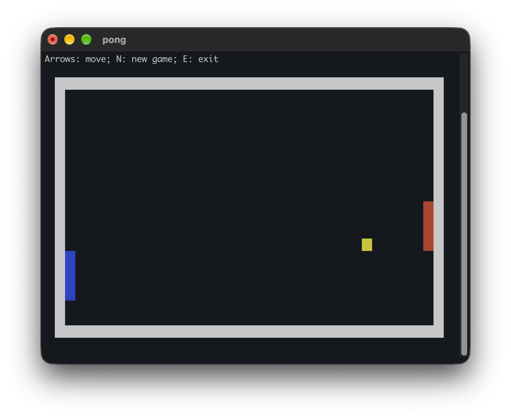

# Terminal Games

## Maze

## Pong

## Snake

## Tetris

## Run and Test

Run `make` or `make test` at the repository root to run library and game tests.
Run `make` or `make test` in `lib/` for shared-library tests, or in `games/` for
game tests. Each game folder defaults to its tests; use `make run` there to
start that game.
